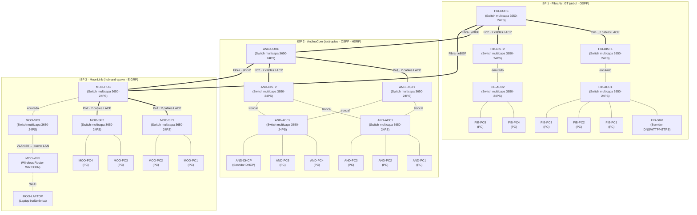

<div align="center">


# Proyecto Conectividad XXI

### Integración de Operadores Nacionales

**Universidad de San Carlos de Guatemala**  
Facultad de Ingeniería · Ingeniería en Ciencias y Sistemas

<br />


**Segundo semestre de 2026**

<br />


</div>

---

## Información académica

| Campo | Información |
|:--|:--|
| **Estudiante** | Hugo Jorge Luis Pérez Arana |
| **Registro académico** | 201504070 |
| **Catedrático** | Ing. Allan Alberto Morataya Gómez |
| **Auxiliar** | Dominic Juan Pablo Ruano Pérez |
| **Sección** | N |

---

## Descripción del proyecto

El proyecto consiste en diseñar e implementar una infraestructura nacional de telecomunicaciones que interconecte tres proveedores de servicio (ISP): FibraNet GT, AndinaCom y MoonLink. Cada ISP tiene requisitos específicos de topología, protocolo de enrutamiento interno (OSPF, EIGRP) y servicios críticos. La interconexión entre ISPs se realiza mediante eBGP sobre fibra óptica, utilizando la red `192.168.XX.0` asignada con los últimos dos dígitos del carné.

Todo se implementa en Cisco Packet Tracer (archivo `Proyecto2_201504070.pkt`) y todas las configuraciones se aplican desde la CLI, excepto en el router inalámbrico, que solo ofrece interfaz gráfica.

## Estado del proyecto

| Etapa | Estado |
|:--|:--|
| Diseño, subneteo y plan de direccionamiento | Terminado |
| Cableado físico en Packet Tracer (39 cables, módulos de fibra instalados) | Terminado |
| Configuración de dispositivos | Pendiente (se hará por fases, ver [Plan de configuración](#plan-de-configuración)) |
| Servicios, ACLs y pruebas | Pendiente |
| Wireshark, manual técnico y presentación | Pendiente |

---

## Subneteo y plan de direccionamiento

### Variables derivadas del carné

Con el carné **201504070** se obtienen los siguientes valores:

| Variable | Regla del enunciado | Valor |
|:--|:--|:--|
| `XX` | Últimos 2 dígitos del carné | `70` |
| `X` (FibraNet y AndinaCom) | Último dígito del carné | `0` |
| `X` (MoonLink) | Primer dígito del carné | `2` |

### Redes asignadas

| Red | Uso | Dirección asignada |
|:--|:--|:--|
| ISP 1 | FibraNet GT | `172.16.10.0/24` |
| ISP 2 | AndinaCom | `172.16.20.0/24` |
| ISP 3 | MoonLink | `172.16.32.0/24` |
| Interconexión | Enlaces entre switches multicapa y enlaces internos de FibraNet | `192.168.70.0/24` (bloque de trabajo) |

---

### ISP 1: FibraNet GT (`172.16.10.0/24`)

Cada departamento debe soportar hasta **75 hosts**. Con 7 bits de host se obtienen 2⁷ − 2 = 126 direcciones utilizables, por lo que se requiere una máscara **/25** (`255.255.255.128`). Con 6 bits solo se obtendrían 62, insuficientes.

| Departamento | VLAN | Red | Máscara | Rango utilizable | Broadcast | Gateway |
|:--|:--:|:--|:--|:--|:--|:--|
| Administración | 10 | `172.16.10.0/25` | `255.255.255.128` | `.1` – `.126` | `.127` | `172.16.10.1` |
| Atención al Cliente | 20 | `172.16.10.128/25` | `255.255.255.128` | `.129` – `.254` | `.255` | `172.16.10.129` |

**Servidor DNS y HTTP/HTTPS:** se ubica dentro de la subred de Administración, con dirección estática reservada fuera del rango de DHCP.

| Elemento | Dirección |
|:--|:--|
| Rango reservado para servidores (excluido de DHCP) | `172.16.10.110` – `172.16.10.126` |
| Servidor DNS / HTTP / HTTPS (`FIB-SRV`) | `172.16.10.125` |

---

### ISP 2: AndinaCom (`172.16.20.0/24`)

El tamaño de las subredes es libre. Se utilizan subredes /26 para los departamentos (62 hosts utilizables cada una), una subred /27 para el servidor DHCP y un bloque /26 reservado para enlaces punto a punto. La topología jerárquica con HSRP requiere en cada subred una dirección virtual y dos direcciones reales (una por cada switch multicapa de distribución).

| Subred | VLAN | Red | Máscara | Rango utilizable | Broadcast | HSRP virtual | Real (Dist-1 / Dist-2) |
|:--|:--:|:--|:--|:--|:--|:--|:--|
| Ventas | 30 | `172.16.20.0/26` | `255.255.255.192` | `.1` – `.62` | `.63` | `172.16.20.1` | `.2` / `.3` |
| Facturación | 40 | `172.16.20.64/26` | `255.255.255.192` | `.65` – `.126` | `.127` | `172.16.20.65` | `.66` / `.67` |
| Servidores (DHCP) | 50 | `172.16.20.128/27` | `255.255.255.224` | `.129` – `.158` | `.159` | `172.16.20.129` | `.130` / `.131` |
| Reserva | — | `172.16.20.160/27` | `255.255.255.224` | `.161` – `.190` | `.191` | — | — |
| Enlaces punto a punto | — | `172.16.20.192/26` | `255.255.255.192` | Subdividido en /30 | `.255` | — | — |

| Elemento | Dirección |
|:--|:--|
| Servidor DHCP centralizado (`AND-DHCP`) | `172.16.20.132` |

Enlaces punto a punto (/30) dentro de `172.16.20.192/26`:

| Enlace | VLAN de tránsito | Red | Hosts utilizables |
|:--|:--:|:--|:--|
| `AND-CORE` – `AND-DIST1` | 111 | `172.16.20.192/30` | `.193` (CORE) – `.194` (DIST1) |
| `AND-CORE` – `AND-DIST2` | 112 | `172.16.20.196/30` | `.197` (CORE) – `.198` (DIST2) |

Los 14 bloques /30 restantes (`172.16.20.200/30` hasta `172.16.20.252/30`) quedan libres.

---

### ISP 3: MoonLink (`172.16.32.0/24`)

Cada departamento debe soportar hasta **45 hosts**. Con 6 bits de host se obtienen 2⁶ − 2 = 62 direcciones utilizables, por lo que se requiere una máscara **/26** (`255.255.255.192`). Con 5 bits solo se obtendrían 30, insuficientes.

| Subred | VLAN | Red | Máscara | Rango utilizable | Broadcast | Hosts | Gateway |
|:--|:--:|:--|:--|:--|:--|:--:|:--|
| Soporte | 60 | `172.16.32.0/26` | `255.255.255.192` | `.1` – `.62` | `.63` | 62 | `172.16.32.1` |
| Seguridad | 70 | `172.16.32.64/26` | `255.255.255.192` | `.65` – `.126` | `.127` | 62 | `172.16.32.65` |
| Soporte inalámbrico (Wi-Fi) | 80 | `172.16.32.128/26` | `255.255.255.192` | `.129` – `.190` | `.191` | 62 | `172.16.32.129` |
| Enlaces punto a punto | — | `172.16.32.192/26` | `255.255.255.192` | Subdividido en /30 | `.255` | — | — |

Enlaces punto a punto (/30) para la topología hub-and-spoke dentro de `172.16.32.192/26`:

| Enlace | VLAN de tránsito | Red | Hosts utilizables |
|:--|:--:|:--|:--|
| `MOO-HUB` – `MOO-SP1` | 121 | `172.16.32.192/30` | `.193` (HUB) – `.194` (SP1) |
| `MOO-HUB` – `MOO-SP2` | 122 | `172.16.32.196/30` | `.197` (HUB) – `.198` (SP2) |
| `MOO-HUB` – `MOO-SP3` | — (puerto enrutado) | `172.16.32.200/30` | `.201` (HUB) – `.202` (SP3) |
| Reservado (futuro spoke) | — | `172.16.32.204/30` | `.205` – `.206` |

Los 12 bloques /30 restantes (`172.16.32.208/30` hasta `172.16.32.252/30`) quedan libres.

---

### Red de interconexión (`192.168.70.0`)

#### Enlaces eBGP entre los switches multicapa de borde

Cada enlace punto a punto utiliza una máscara **/30** (`255.255.255.252`), que ofrece exactamente 2 direcciones utilizables y evita el desperdicio de direcciones.

| Enlace | Red | Extremo A | Extremo B | AS A / AS B |
|:--|:--|:--|:--|:--|
| FibraNet GT – AndinaCom | `192.168.70.0/30` | `192.168.70.1` (`FIB-CORE` `Gi1/1/1`) | `192.168.70.2` (`AND-CORE` `Gi1/1/1`) | 65001 / 65002 |
| AndinaCom – MoonLink | `192.168.70.4/30` | `192.168.70.5` (`AND-CORE` `Gi1/1/2`) | `192.168.70.6` (`MOO-HUB` `Gi1/1/1`) | 65002 / 65003 |
| FibraNet GT – MoonLink | `192.168.70.8/30` | `192.168.70.9` (`FIB-CORE` `Gi1/1/2`) | `192.168.70.10` (`MOO-HUB` `Gi1/1/2`) | 65001 / 65003 |
| Reserva | `192.168.70.12/30` | — | — | — |

El conjunto completo de enlaces BGP se resume en `192.168.70.0/28`.

#### Enlaces internos de FibraNet GT

Las dos subredes /25 consumen todo `172.16.10.0/24`, por eso los enlaces internos de este ISP salen de `192.168.70.16/27` (ocho /30 disponibles, cuatro usados):

| Enlace | VLAN de tránsito | Red | Extremo A | Extremo B |
|:--|:--:|:--|:--|:--|
| `FIB-CORE` – `FIB-DIST1` | 101 | `192.168.70.16/30` | `.17` (CORE) | `.18` (DIST1) |
| `FIB-CORE` – `FIB-DIST2` | 102 | `192.168.70.20/30` | `.21` (CORE) | `.22` (DIST2) |
| `FIB-DIST1` – `FIB-ACC1` | — (puerto enrutado) | `192.168.70.24/30` | `.25` (DIST1) | `.26` (ACC1) |
| `FIB-DIST2` – `FIB-ACC2` | — (puerto enrutado) | `192.168.70.28/30` | `.29` (DIST2) | `.30` (ACC2) |

Los bloques `192.168.70.32/30`, `.36/30`, `.40/30` y `.44/30` quedan libres, y desde `192.168.70.48/28` hay reserva para crecimiento.

---

### Resumen general

| ISP | AS | Red asignada | Subredes de usuario | Máscara | Protocolo interno | Topología |
|:--|:--:|:--|:--|:--:|:--|:--|
| FibraNet GT | 65001 | `172.16.10.0/24` | Administración, Atención al Cliente | /25 | OSPF (área 0) | Árbol |
| AndinaCom | 65002 | `172.16.20.0/24` | Ventas, Facturación | /26 | OSPF (área 0) | Jerárquica (HSRP) |
| MoonLink | 65003 | `172.16.32.0/24` | Soporte, Seguridad (+ Wi-Fi de Soporte) | /26 | EIGRP (AS 10) | Hub-and-spoke |

---

## Direccionamiento por dispositivo

Resumen de las direcciones de cada interfaz enrutada o SVI, para consultar durante la configuración. Los hosts reciben su IP por DHCP.

### FibraNet GT

| Dispositivo | Interfaz | Dirección | Notas |
|:--|:--|:--|:--|
| `FIB-CORE` | SVI VLAN 101 | `192.168.70.17/30` | Hacia `FIB-DIST1` |
| `FIB-CORE` | SVI VLAN 102 | `192.168.70.21/30` | Hacia `FIB-DIST2` |
| `FIB-CORE` | `Gi1/1/1` | `192.168.70.1/30` | Fibra a `AND-CORE` |
| `FIB-CORE` | `Gi1/1/2` | `192.168.70.9/30` | Fibra a `MOO-HUB` |
| `FIB-DIST1` | SVI VLAN 101 | `192.168.70.18/30` | Hacia `FIB-CORE` |
| `FIB-DIST1` | `Gi1/0/3` | `192.168.70.25/30` | Hacia `FIB-ACC1` (puerto enrutado) |
| `FIB-DIST2` | SVI VLAN 102 | `192.168.70.22/30` | Hacia `FIB-CORE` |
| `FIB-DIST2` | `Gi1/0/3` | `192.168.70.29/30` | Hacia `FIB-ACC2` (puerto enrutado) |
| `FIB-ACC1` | `Gi1/0/1` | `192.168.70.26/30` | Hacia `FIB-DIST1` (puerto enrutado) |
| `FIB-ACC1` | SVI VLAN 10 | `172.16.10.1/25` | Gateway de Administración |
| `FIB-ACC2` | `Gi1/0/1` | `192.168.70.30/30` | Hacia `FIB-DIST2` (puerto enrutado) |
| `FIB-ACC2` | SVI VLAN 20 | `172.16.10.129/25` | Gateway de Atención al Cliente |
| `FIB-SRV` | `Fa0` | `172.16.10.125/25` | Gateway `172.16.10.1` (estático) |

### AndinaCom

| Dispositivo | Interfaz | Dirección | Notas |
|:--|:--|:--|:--|
| `AND-CORE` | SVI VLAN 111 | `172.16.20.193/30` | Hacia `AND-DIST1` |
| `AND-CORE` | SVI VLAN 112 | `172.16.20.197/30` | Hacia `AND-DIST2` |
| `AND-CORE` | `Gi1/1/1` | `192.168.70.2/30` | Fibra a `FIB-CORE` |
| `AND-CORE` | `Gi1/1/2` | `192.168.70.5/30` | Fibra a `MOO-HUB` |
| `AND-DIST1` | SVI VLAN 111 | `172.16.20.194/30` | Hacia `AND-CORE` |
| `AND-DIST1` | SVI VLAN 30 / 40 / 50 | `172.16.20.2/26` · `172.16.20.66/26` · `172.16.20.130/27` | Reales de HSRP |
| `AND-DIST2` | SVI VLAN 112 | `172.16.20.198/30` | Hacia `AND-CORE` |
| `AND-DIST2` | SVI VLAN 30 / 40 / 50 | `172.16.20.3/26` · `172.16.20.67/26` · `172.16.20.131/27` | Reales de HSRP |
| Virtuales HSRP | VLAN 30 / 40 / 50 | `172.16.20.1` · `172.16.20.65` · `172.16.20.129` | Gateways de los hosts |
| `AND-DHCP` | `Fa0` | `172.16.20.132/27` | Gateway `172.16.20.129` (estático) |

### MoonLink

| Dispositivo | Interfaz | Dirección | Notas |
|:--|:--|:--|:--|
| `MOO-HUB` | SVI VLAN 121 | `172.16.32.193/30` | Hacia `MOO-SP1` |
| `MOO-HUB` | SVI VLAN 122 | `172.16.32.197/30` | Hacia `MOO-SP2` |
| `MOO-HUB` | `Gi1/0/6` | `172.16.32.201/30` | Hacia `MOO-SP3` (puerto enrutado) |
| `MOO-HUB` | `Gi1/1/1` | `192.168.70.6/30` | Fibra a `AND-CORE` |
| `MOO-HUB` | `Gi1/1/2` | `192.168.70.10/30` | Fibra a `FIB-CORE` |
| `MOO-SP1` | SVI VLAN 121 | `172.16.32.194/30` | Hacia `MOO-HUB` |
| `MOO-SP1` | SVI VLAN 60 | `172.16.32.1/26` | Gateway de Soporte |
| `MOO-SP2` | SVI VLAN 122 | `172.16.32.198/30` | Hacia `MOO-HUB` |
| `MOO-SP2` | SVI VLAN 70 | `172.16.32.65/26` | Gateway de Seguridad |
| `MOO-SP3` | `Gi1/0/2` | `172.16.32.202/30` | Hacia `MOO-HUB` (puerto enrutado) |
| `MOO-SP3` | SVI VLAN 80 | `172.16.32.129/26` | Gateway de Soporte Wi-Fi |
| `MOO-WIFI` | Gestión | `172.16.32.130/26` | Estático, puerto LAN al `MOO-SP3` |

---

## VLANs y enlaces troncales

Cada ISP es un dominio independiente, por lo que sus VLANs no se mezclan. Las VLANs de tránsito (101, 102, 111, 112, 121, 122) solo existen en el troncal del port-channel correspondiente.

| ISP | VLAN | Nombre | Red | Dónde existe |
|:--|:--:|:--|:--|:--|
| FibraNet GT | 10 | ADMINISTRACION | `172.16.10.0/25` | `FIB-ACC1` (SVI gateway) |
| FibraNet GT | 20 | ATENCION | `172.16.10.128/25` | `FIB-ACC2` (SVI gateway) |
| FibraNet GT | 101 | TRANSITO-C-D1 | `192.168.70.16/30` | Troncal `Po1` (`FIB-CORE` – `FIB-DIST1`) |
| FibraNet GT | 102 | TRANSITO-C-D2 | `192.168.70.20/30` | Troncal `Po2` (`FIB-CORE` – `FIB-DIST2`) |
| AndinaCom | 30 | VENTAS | `172.16.20.0/26` | `AND-DIST1`, `AND-DIST2`, `AND-ACC1` |
| AndinaCom | 40 | FACTURACION | `172.16.20.64/26` | `AND-DIST1`, `AND-DIST2`, `AND-ACC2` |
| AndinaCom | 50 | SERVIDORES | `172.16.20.128/27` | `AND-DIST1`, `AND-DIST2`, `AND-ACC2` |
| AndinaCom | 111 | TRANSITO-C-D1 | `172.16.20.192/30` | Troncal `Po1` (`AND-CORE` – `AND-DIST1`) |
| AndinaCom | 112 | TRANSITO-C-D2 | `172.16.20.196/30` | Troncal `Po2` (`AND-CORE` – `AND-DIST2`) |
| MoonLink | 60 | SOPORTE | `172.16.32.0/26` | `MOO-SP1` (SVI gateway) |
| MoonLink | 70 | SEGURIDAD | `172.16.32.64/26` | `MOO-SP2` (SVI gateway) |
| MoonLink | 80 | SOPORTE-WIFI | `172.16.32.128/26` | `MOO-SP3` (SVI gateway) |
| MoonLink | 121 | TRANSITO-H-S1 | `172.16.32.192/30` | Troncal `Po1` (`MOO-HUB` – `MOO-SP1`) |
| MoonLink | 122 | TRANSITO-H-S2 | `172.16.32.196/30` | Troncal `Po2` (`MOO-HUB` – `MOO-SP2`) |

### Enlaces LACP (mínimo 2 por ISP)

| ISP | Port-channel | Extremos | Puertos | Modo |
|:--|:--|:--|:--|:--|
| FibraNet GT | `Po1` | `FIB-CORE` – `FIB-DIST1` | `Gi1/0/1-2` en ambos | LACP (`active`), troncal solo VLAN 101 |
| FibraNet GT | `Po2` | `FIB-CORE` – `FIB-DIST2` | `Gi1/0/3-4` (CORE) y `Gi1/0/1-2` (DIST2) | LACP (`active`), troncal solo VLAN 102 |
| AndinaCom | `Po1` | `AND-CORE` – `AND-DIST1` | `Gi1/0/1-2` en ambos | LACP (`active`), troncal solo VLAN 111 |
| AndinaCom | `Po2` | `AND-CORE` – `AND-DIST2` | `Gi1/0/3-4` (CORE) y `Gi1/0/1-2` (DIST2) | LACP (`active`), troncal solo VLAN 112 |
| MoonLink | `Po1` | `MOO-HUB` – `MOO-SP1` | `Gi1/0/1-2` en ambos | LACP (`active`), troncal solo VLAN 121 |
| MoonLink | `Po2` | `MOO-HUB` – `MOO-SP2` | `Gi1/0/3-4` (HUB) y `Gi1/0/1-2` (SP2) | LACP (`active`), troncal solo VLAN 122 |

---

## HSRP en AndinaCom

`AND-DIST1` y `AND-DIST2` forman la pareja HSRP. Cada VLAN de usuario tiene una IP virtual, y el reparto de roles equilibra la carga. El switch activo de cada VLAN coincide con la raíz de Spanning Tree de esa VLAN, de modo que el tráfico no hace saltos innecesarios entre distribución y acceso.

| VLAN | IP virtual | `AND-DIST1` | `AND-DIST2` | Activo (prioridad 110, `preempt`) | Raíz STP |
|:--|:--|:--|:--|:--|:--|
| 30 Ventas | `172.16.20.1` | `.2` | `.3` | `AND-DIST1` | `AND-DIST1` |
| 40 Facturación | `172.16.20.65` | `.66` | `.67` | `AND-DIST2` | `AND-DIST2` |
| 50 Servidores | `172.16.20.129` | `.130` | `.131` | `AND-DIST1` | `AND-DIST1` |

El switch que no es activo en una VLAN mantiene prioridad 100. Las SVIs de usuario se declaran pasivas en OSPF.

---

## Servicios centralizados

### DNS y HTTP/HTTPS (FibraNet GT)

| Parámetro | Valor |
|:--|:--|
| Servidor | `FIB-SRV` (`172.16.10.125`, estático) |
| Dominio | `www.proyecto2_201504070.com` |
| Contenido | Página estática con los datos del estudiante e información básica del curso |
| Protocolos | HTTP y HTTPS habilitados |

### DHCP (AndinaCom)

El servidor `AND-DHCP` (`172.16.20.132`) entrega direcciones a los tres ISP mediante `ip helper-address 172.16.20.132` en cada SVI de usuario. La VLAN 50 no lleva helper, porque el servidor vive en esa subred. El servidor entrega como DNS `172.16.10.125`.

| VLAN | Gateway entregado | Pool DHCP | Observación |
|:--|:--|:--|:--|
| 10 Administración | `172.16.10.1` | `172.16.10.2` – `.109` | Excluye `.110` – `.126` (servidores) |
| 20 Atención | `172.16.10.129` | `172.16.10.130` – `.254` | — |
| 30 Ventas | `172.16.20.1` (HSRP) | `172.16.20.4` – `.62` | Excluye `.2` y `.3` (reales) |
| 40 Facturación | `172.16.20.65` (HSRP) | `172.16.20.68` – `.126` | Excluye `.66` y `.67` (reales) |
| 60 Soporte | `172.16.32.1` | `172.16.32.2` – `.62` | — |
| 70 Seguridad | `172.16.32.65` | `172.16.32.66` – `.126` | — |
| 80 Soporte Wi-Fi | `172.16.32.129` | `172.16.32.131` – `.190` | `.130` reservada para el WRT300N |

Los dos servidores (`FIB-SRV` y `AND-DHCP`) llevan IP estática porque ofrecen los servicios. Los 15 equipos de usuario (14 PCs y 1 laptop) obtienen su IP por DHCP.

### Red inalámbrica (MoonLink)

El dispositivo es el **Wireless Router WRT300N** de Packet Tracer (categoría Wireless Devices). Este modelo no soporta relay DHCP, por lo que se usa como puente inalámbrico:

| Parámetro | Valor |
|:--|:--|
| Conexión | Puerto LAN (`Ethernet 1`) del WRT300N a `MOO-SP3` `Gi1/0/1`, puerto de acceso VLAN 80 (el puerto Internet queda libre) |
| DHCP en el WRT300N | Apagado |
| IP de gestión | `172.16.32.130/26` (estática) |
| Seguridad | WPA2-PSK, SSID `MoonLink-WiFi` |
| Cliente | `MOO-LAPTOP` (Laptop-PT, tarjeta WPC300N incluida), conectada solo por Wi-Fi, sin cable |

Como el WRT300N solo tiene interfaz gráfica, es el único dispositivo que no se configura por CLI.

---

## Reglas de comunicación (ACLs extendidas)

Las ACLs se aplican **inbound en la SVI de cada departamento**, lo más cerca posible del origen. Como las ACLs no guardan estado, cada una se escribe desde la perspectiva de su departamento de origen.

| Departamento | ACL | Dispositivo(s) | Interfaz | Sentido |
|:--|:--|:--|:--|:--:|
| Administración | `ACL-ADMIN` | `FIB-ACC1` | SVI VLAN 10 | in |
| Atención al Cliente | `ACL-ATENCION` | `FIB-ACC2` | SVI VLAN 20 | in |
| Ventas | `ACL-VENTAS` | `AND-DIST1` y `AND-DIST2` (idéntica en ambos) | SVI VLAN 30 | in |
| Facturación | `ACL-FACTURACION` | `AND-DIST1` y `AND-DIST2` (idéntica en ambos) | SVI VLAN 40 | in |
| Soporte | `ACL-SOPORTE` | `MOO-SP1` | SVI VLAN 60 | in |
| Seguridad | `ACL-SEGURIDAD` | `MOO-SP2` | SVI VLAN 70 | in |
| Soporte Wi-Fi | `ACL-SOPORTE` (mismas reglas) | `MOO-SP3` | SVI VLAN 80 | in |

### Orden de reglas en cada ACL

1. **DHCP del cliente:** permitir `udp any eq bootpc any eq bootps`. El broadcast `DHCPDISCOVER` entra por la SVI y sin esta regla el host no obtiene IP.
2. **DNS:** permitir `udp any host 172.16.10.125 eq 53`. En `ACL-ADMIN` se permite además la respuesta (`udp host 172.16.10.125 eq 53 any`), porque el servidor vive en esa VLAN.
3. **Respuestas:** permitir `tcp any any established` e `icmp any any echo-reply`, para que funcionen las respuestas de sesiones permitidas.
4. **Seguridad como destino:** denegar todo tráfico nuevo hacia `172.16.32.64 0.0.0.63` (no aplica en `ACL-SEGURIDAD`).
5. **Reglas por destino** según la tabla siguiente.
6. **Denegación implícita** al final.

### Permisos por departamento de origen (tabla 4.2)

| Origen | Destinos permitidos | Protocolos | Destinos bloqueados |
|:--|:--|:--|:--|
| Seguridad | Cualquier departamento | ICMP, TCP/80, TCP/443 | — |
| Soporte (y Wi-Fi) | Cualquier departamento excepto Seguridad | ICMP, TCP/80, TCP/443 | Seguridad (solo respuestas) |
| Administración | Cualquier departamento excepto Seguridad | ICMP, TCP/80, TCP/443 | Seguridad (solo respuestas) |
| Atención al Cliente | Administración, Soporte | ICMP, TCP/80, TCP/443 | Facturación, Seguridad |
| Atención al Cliente | Ventas | ICMP, TCP/80 | — |
| Ventas | Facturación, Atención al Cliente | ICMP, TCP/80 | Seguridad (solo respuestas) |
| Ventas | Administración, Soporte | ICMP, TCP/80, TCP/443 | — |
| Facturación | Ventas | ICMP, TCP/80 | Atención al Cliente, Seguridad |
| Facturación | Administración, Soporte | ICMP, TCP/80, TCP/443 | — |

---

## Topología física



### Identificación de componentes

| Nombre | Tipo de dispositivo | ISP | Función |
|:--|:--|:--|:--|
| `FIB-CORE` | Switch multicapa 3650-24PS | FibraNet GT | Raíz del árbol y borde BGP (AS 65001) |
| `FIB-DIST1`, `FIB-DIST2` | Switch multicapa 3650-24PS | FibraNet GT | Distribución |
| `FIB-ACC1` | Switch multicapa 3650-24PS | FibraNet GT | Gateway de Administración (VLAN 10) |
| `FIB-ACC2` | Switch multicapa 3650-24PS | FibraNet GT | Gateway de Atención al Cliente (VLAN 20) |
| `FIB-SRV` | Servidor | FibraNet GT | DNS y HTTP/HTTPS |
| `FIB-PC1` a `FIB-PC3` | PC | FibraNet GT | Hosts de Administración |
| `FIB-PC4`, `FIB-PC5` | PC | FibraNet GT | Hosts de Atención al Cliente |
| `AND-CORE` | Switch multicapa 3650-24PS | AndinaCom | Núcleo y borde BGP (AS 65002) |
| `AND-DIST1`, `AND-DIST2` | Switch multicapa 3650-24PS | AndinaCom | Distribución, pareja HSRP y gateways de Ventas, Facturación y Servidores |
| `AND-ACC1` | Switch multicapa 3650-24PS (rol de capa 2) | AndinaCom | Acceso de Ventas |
| `AND-ACC2` | Switch multicapa 3650-24PS (rol de capa 2) | AndinaCom | Acceso de Facturación y servidor DHCP |
| `AND-DHCP` | Servidor | AndinaCom | DHCP para los tres ISP |
| `AND-PC1` a `AND-PC3` | PC | AndinaCom | Hosts de Ventas |
| `AND-PC4`, `AND-PC5` | PC | AndinaCom | Hosts de Facturación |
| `MOO-HUB` | Switch multicapa 3650-24PS | MoonLink | Hub y borde BGP (AS 65003) |
| `MOO-SP1` | Switch multicapa 3650-24PS | MoonLink | Spoke y gateway de Soporte (VLAN 60) |
| `MOO-SP2` | Switch multicapa 3650-24PS | MoonLink | Spoke y gateway de Seguridad (VLAN 70) |
| `MOO-SP3` | Switch multicapa 3650-24PS | MoonLink | Spoke y gateway de Soporte Wi-Fi (VLAN 80) |
| `MOO-WIFI` | Wireless Router WRT300N | MoonLink | Servicio Wi-Fi en modo puente (DHCP apagado, conectado por puerto LAN) |
| `MOO-LAPTOP` | Laptop-PT | MoonLink | Cliente inalámbrico |
| `MOO-PC1`, `MOO-PC2` | PC | MoonLink | Hosts de Soporte |
| `MOO-PC3`, `MOO-PC4` | PC | MoonLink | Hosts de Seguridad |

**Totales:** 14 switches multicapa 3650-24PS, 1 Wireless Router WRT300N, 15 equipos de usuario (14 PCs y 1 laptop), 2 servidores y 39 cables (36 de cobre y 3 de fibra), más el enlace inalámbrico de la laptop.

---

## Conexiones por puerto

Estas tablas son el cableado real armado en Packet Tracer. Los cables entre switches son cruzados (Copper Cross Over) y los de hosts y servidores son directos (Copper Straight-Through).

### FibraNet GT (12 cables)

| Origen | Puerto | Destino | Puerto | Cable |
|:--|:--|:--|:--|:--|
| `FIB-CORE` | `Gi1/0/1` | `FIB-DIST1` | `Gi1/0/1` | Cruzado |
| `FIB-CORE` | `Gi1/0/2` | `FIB-DIST1` | `Gi1/0/2` | Cruzado |
| `FIB-CORE` | `Gi1/0/3` | `FIB-DIST2` | `Gi1/0/1` | Cruzado |
| `FIB-CORE` | `Gi1/0/4` | `FIB-DIST2` | `Gi1/0/2` | Cruzado |
| `FIB-DIST1` | `Gi1/0/3` | `FIB-ACC1` | `Gi1/0/1` | Cruzado |
| `FIB-DIST2` | `Gi1/0/3` | `FIB-ACC2` | `Gi1/0/1` | Cruzado |
| `FIB-ACC1` | `Gi1/0/2` | `FIB-PC1` | `Fa0` | Directo |
| `FIB-ACC1` | `Gi1/0/3` | `FIB-PC2` | `Fa0` | Directo |
| `FIB-ACC1` | `Gi1/0/4` | `FIB-PC3` | `Fa0` | Directo |
| `FIB-ACC1` | `Gi1/0/5` | `FIB-SRV` | `Fa0` | Directo |
| `FIB-ACC2` | `Gi1/0/2` | `FIB-PC4` | `Fa0` | Directo |
| `FIB-ACC2` | `Gi1/0/3` | `FIB-PC5` | `Fa0` | Directo |

### AndinaCom (14 cables)

| Origen | Puerto | Destino | Puerto | Cable |
|:--|:--|:--|:--|:--|
| `AND-CORE` | `Gi1/0/1` | `AND-DIST1` | `Gi1/0/1` | Cruzado |
| `AND-CORE` | `Gi1/0/2` | `AND-DIST1` | `Gi1/0/2` | Cruzado |
| `AND-CORE` | `Gi1/0/3` | `AND-DIST2` | `Gi1/0/1` | Cruzado |
| `AND-CORE` | `Gi1/0/4` | `AND-DIST2` | `Gi1/0/2` | Cruzado |
| `AND-DIST1` | `Gi1/0/3` | `AND-ACC1` | `Gi1/0/1` | Cruzado |
| `AND-DIST2` | `Gi1/0/3` | `AND-ACC2` | `Gi1/0/1` | Cruzado |
| `AND-DIST2` | `Gi1/0/4` | `AND-ACC1` | `Gi1/0/5` | Cruzado |
| `AND-ACC2` | `Gi1/0/5` | `AND-DIST1` | `Gi1/0/4` | Cruzado |
| `AND-ACC1` | `Gi1/0/2` | `AND-PC1` | `Fa0` | Directo |
| `AND-ACC1` | `Gi1/0/3` | `AND-PC2` | `Fa0` | Directo |
| `AND-ACC1` | `Gi1/0/4` | `AND-PC3` | `Fa0` | Directo |
| `AND-ACC2` | `Gi1/0/2` | `AND-PC4` | `Fa0` | Directo |
| `AND-ACC2` | `Gi1/0/3` | `AND-PC5` | `Fa0` | Directo |
| `AND-ACC2` | `Gi1/0/4` | `AND-DHCP` | `Fa0` | Directo |

### MoonLink (10 cables)

| Origen | Puerto | Destino | Puerto | Cable |
|:--|:--|:--|:--|:--|
| `MOO-HUB` | `Gi1/0/1` | `MOO-SP1` | `Gi1/0/1` | Cruzado |
| `MOO-HUB` | `Gi1/0/2` | `MOO-SP1` | `Gi1/0/2` | Cruzado |
| `MOO-HUB` | `Gi1/0/3` | `MOO-SP2` | `Gi1/0/1` | Cruzado |
| `MOO-HUB` | `Gi1/0/4` | `MOO-SP2` | `Gi1/0/2` | Cruzado |
| `MOO-HUB` | `Gi1/0/6` | `MOO-SP3` | `Gi1/0/2` | Cruzado |
| `MOO-SP1` | `Gi1/0/3` | `MOO-PC1` | `Fa0` | Directo |
| `MOO-SP1` | `Gi1/0/4` | `MOO-PC2` | `Fa0` | Directo |
| `MOO-SP2` | `Gi1/0/3` | `MOO-PC3` | `Fa0` | Directo |
| `MOO-SP2` | `Gi1/0/4` | `MOO-PC4` | `Fa0` | Directo |
| `MOO-SP3` | `Gi1/0/1` | `MOO-WIFI` | `Ethernet 1` (LAN) | Directo |

### Interconexión entre ISPs (3 cables de fibra)

| Origen | Puerto | Destino | Puerto | Cable |
|:--|:--|:--|:--|:--|
| `FIB-CORE` | `Gi1/1/1` | `AND-CORE` | `Gi1/1/1` | Fibra |
| `FIB-CORE` | `Gi1/1/2` | `MOO-HUB` | `Gi1/1/2` | Fibra |
| `AND-CORE` | `Gi1/1/2` | `MOO-HUB` | `Gi1/1/1` | Fibra |

### Función de cada puerto

| Dispositivo | Puertos y función |
|:--|:--|
| `FIB-CORE` | `Gi1/0/1-2` → `Po1` (VLAN 101) · `Gi1/0/3-4` → `Po2` (VLAN 102) · `Gi1/1/1` y `Gi1/1/2` enrutados (fibra) |
| `FIB-DIST1` / `FIB-DIST2` | `Gi1/0/1-2` → `Po1` / `Po2` · `Gi1/0/3` enrutado hacia el acceso |
| `FIB-ACC1` | `Gi1/0/1` enrutado · `Gi1/0/2-5` acceso VLAN 10 (PC1, PC2, PC3, SRV) |
| `FIB-ACC2` | `Gi1/0/1` enrutado · `Gi1/0/2-3` acceso VLAN 20 (PC4, PC5) |
| `AND-CORE` | `Gi1/0/1-2` → `Po1` (VLAN 111) · `Gi1/0/3-4` → `Po2` (VLAN 112) · `Gi1/1/1` y `Gi1/1/2` enrutados (fibra) |
| `AND-DIST1` | `Gi1/0/1-2` → `Po1` · `Gi1/0/3` troncal a ACC1 · `Gi1/0/4` troncal a ACC2 |
| `AND-DIST2` | `Gi1/0/1-2` → `Po2` · `Gi1/0/3` troncal a ACC2 · `Gi1/0/4` troncal a ACC1 |
| `AND-ACC1` | `Gi1/0/1` y `Gi1/0/5` troncales (DIST1 y DIST2) · `Gi1/0/2-4` acceso VLAN 30 |
| `AND-ACC2` | `Gi1/0/1` y `Gi1/0/5` troncales (DIST2 y DIST1) · `Gi1/0/2-3` acceso VLAN 40 · `Gi1/0/4` acceso VLAN 50 |
| `MOO-HUB` | `Gi1/0/1-2` → `Po1` (VLAN 121) · `Gi1/0/3-4` → `Po2` (VLAN 122) · `Gi1/0/6` enrutado a SP3 · `Gi1/1/1` y `Gi1/1/2` enrutados (fibra) |
| `MOO-SP1` | `Gi1/0/1-2` → `Po1` · `Gi1/0/3-4` acceso VLAN 60 |
| `MOO-SP2` | `Gi1/0/1-2` → `Po2` · `Gi1/0/3-4` acceso VLAN 70 |
| `MOO-SP3` | `Gi1/0/2` enrutado a HUB · `Gi1/0/1` acceso VLAN 80 (WRT300N) |

---

## Decisiones de diseño

1. **Interpretación de `192.168.XX.0/16`.** La dirección `192.168.70.0` con máscara /16 no es una dirección de red válida, ya que la red correspondiente sería `192.168.0.0/16`. Se tomó `192.168.70.0/24` como bloque de trabajo y se subdividió en subredes /30, con lo que se garantiza un subneteo eficiente.
2. **Enlaces internos de FibraNet GT.** Las dos subredes /25 consumen la totalidad de `172.16.10.0/24`, sin direcciones disponibles para los enlaces entre switches. El enunciado indica que la red `192.168.XX.0` se asigna para conectar routers y switches de capa 3, por lo que los cuatro enlaces internos de este ISP se tomaron de `192.168.70.16/27`. Así se respeta el requisito de 75 hosts por departamento.
3. **Ubicación del servidor DNS/HTTP.** Dado que FibraNet GT no dispone de una subred adicional, el servidor se ubica en la subred de Administración. Este departamento mantiene comunicación bidireccional con cualquier otro, de modo que las reglas de la tabla 4.2 no afectan el acceso al servicio.
4. **Subred de servidores en AndinaCom.** Se separó el servidor DHCP en una subred propia (`172.16.20.128/27`, VLAN 50) protegida por HSRP, para que el servicio no dependa de un único gateway.
5. **Red inalámbrica de MoonLink.** La tabla 4.2 solo define seis departamentos, así que la subred Wi-Fi (`172.16.32.128/26`, VLAN 80) se trata como extensión inalámbrica de Soporte y aplica las mismas reglas. El WRT300N de Packet Tracer no soporta relay DHCP, por lo que opera como puente: conectado por su puerto LAN, con DHCP apagado, y los clientes reciben IP del servidor de AndinaCom a través del relay de `MOO-SP3`.
6. **LACP con port-channels de capa 2.** Los enlaces con 2 cables son troncales LACP con una VLAN de tránsito y una SVI /30 en cada extremo, porque el EtherChannel de capa 3 en Packet Tracer tiene comportamiento inconsistente. Cada troncal permite solo su VLAN de tránsito, lo que evita bucles de capa 2. Los enlaces de un solo cable usan puertos enrutados (`no switchport`).
7. **Conflicto en la tabla 4.2.** Las filas de Soporte y Administración dicen "bidireccional con cualquier departamento", mientras que otra fila bloquea "cualquier departamento → Seguridad". Se resolvió dando prioridad a la regla de Seguridad: ningún departamento inicia tráfico hacia Seguridad, solo pasan las respuestas (`echo-reply` y `established`) a lo que Seguridad inició.
8. **Capa 3 en AndinaCom.** Los switches de acceso `AND-ACC1` y `AND-ACC2` son 3650-24PS operando en capa 2, y se cuentan entre los 5 equipos multicapa del ISP, igual que el enunciado llama "routers o switches de capa 3" a los 3650 de su topología base.
9. **Direccionamiento de servidores.** Los servidores `FIB-SRV` y `AND-DHCP` llevan IP estática, porque no pueden obtener por DHCP la dirección con la que ofrecen el servicio. Todos los demás dispositivos finales usan DHCP.
10. **Sin enlace entre `AND-DIST1` y `AND-DIST2`.** Los mensajes HSRP viajan por los switches de acceso, que se conectan a ambas distribuciones. Spanning Tree bloquea uno de los dos caminos de cada VLAN para evitar bucles.

---

## Plan de configuración

La configuración se hace por fases, una a la vez, y cada fase se verifica antes de pasar a la siguiente. Después de cada fase se guarda con `write memory`.

| Fase | Qué se configura | Cómo se verifica | Estado |
|:--:|:--|:--|:--|
| 0 | Confirmar que el 3650-24PS ofrece `router bgp`, y nombrar los 14 equipos (hostname) | `router ?` en un 3650 | Pendiente |
| 1 | FibraNet: VLANs, LACP (`Po1` y `Po2`), SVIs de tránsito, puertos enrutados y puertos de acceso | `show etherchannel summary`, `show ip interface brief` | Pendiente |
| 2 | FibraNet: SVIs gateway (VLAN 10 y 20) y OSPF área 0 en los 5 switches | `show ip ospf neighbor`, ping entre los gateways | Pendiente |
| 3 | `FIB-SRV`: IP estática, DNS (`www.proyecto2_201504070.com`) y HTTP/HTTPS con la página | Navegador desde un PC con IP estática temporal | Pendiente |
| 4 | AndinaCom: VLANs, LACP (`Po1` y `Po2`), SVIs de tránsito, troncales y puertos de acceso | `show etherchannel summary`, `show interfaces trunk` | Pendiente |
| 5 | AndinaCom: SVIs de usuario, HSRP, raíz de STP y OSPF área 0 | `show standby brief`, `show ip ospf neighbor` | Pendiente |
| 6 | `AND-DHCP`: IP estática y los 7 pools; `ip helper-address` en las SVIs de AndinaCom | DHCP DORA en los PCs de AndinaCom, y prueba de conmutación HSRP apagando `AND-DIST1` | Pendiente |
| 7 | MoonLink: VLANs, LACP (`Po1` y `Po2`), SVIs, puerto enrutado a SP3, accesos y EIGRP AS 10 | `show ip eigrp neighbors`, ping entre gateways | Pendiente |
| 8 | MoonLink: WRT300N en modo puente (DHCP apagado, IP de gestión, SSID y WPA2) y asociación de la laptop | La laptop se asocia al SSID | Pendiente |
| 9 | eBGP: IPs de fibra, vecinos, anuncio de los /24, `router-id` y redistribución BGP ↔ OSPF/EIGRP | `show ip bgp summary`, `show ip route`, ping core a core | Pendiente |
| 10 | Servicios entre ISPs: `ip helper-address` en FibraNet y MoonLink, y DNS en los pools | Todos los hosts reciben IP por DHCP; el dominio carga desde cualquier dispositivo; ping entre ISPs | Pendiente |
| 11 | ACLs extendidas por departamento (orden de reglas y tabla 4.2) | Matriz de ping y acceso web entre todos los pares de departamentos | Pendiente |
| 12 | Guardado final (`write memory`), archivo `.pkt`, capturas y pruebas para el manual | Reinicio de dispositivos y revisión de que todo persiste | Pendiente |
| 13 | Captura en Wireshark desde una VM (TCP handshake, DNS, HTTP/HTTPS, ICMP) | Archivo `.pcapng` abre en Wireshark | Pendiente |
| 14 | Práctica del modo simulación (DHCP DORA, DNS, HTTP/HTTPS, OSPF/EIGRP y BGP) | Explicar capa por capa un paquete elegido al azar | Pendiente |
| 15 | Manual técnico, presentación ejecutiva y commits en el repositorio | Entregables completos antes del 23/10/2026 | Pendiente |

### Notas sobre eBGP en Packet Tracer

- Packet Tracer solo soporta eBGP, y no acepta `update-source` ni `ebgp-multihop`. Por eso los vecinos se declaran con las IP directas de cada enlace /30.
- Router IDs sugeridos: `1.1.1.1` (`FIB-CORE`), `2.2.2.2` (`AND-CORE`), `3.3.3.3` (`MOO-HUB`).
- Cada borde anuncia el /24 de su ISP e inyecta lo aprendido por BGP en su protocolo interno (OSPF o EIGRP), para que los equipos internos tengan ruta de regreso.
- Las pruebas de la fase 3 usan una IP estática temporal en un PC, que debe volver a DHCP antes de la evaluación.

---

## Configuración de hostname

FIB-CORE:
```
enable
configure terminal
hostname FIB-CORE
no ip domain-lookup
end
write memory
```

FIB-DIST1:
```
enable
configure terminal
hostname FIB-DIST1
no ip domain-lookup
end
write memory
```

FIB-DIST2:
```
enable
configure terminal
hostname FIB-DIST2
no ip domain-lookup
end
write memory
```

FIB-ACC1:
```
enable
configure terminal
hostname FIB-ACC1
no ip domain-lookup
end
write memory
```

FIB-ACC2:
```
enable
configure terminal
hostname FIB-ACC2
no ip domain-lookup
end
write memory
```

AND-CORE:
```
enable
configure terminal
hostname AND-CORE
no ip domain-lookup
end
write memory
```

AND-DIST1:
```
enable
configure terminal
hostname AND-DIST1
no ip domain-lookup
end
write memory
```

AND-DIST2:
```
enable
configure terminal
hostname AND-DIST2
no ip domain-lookup
end
write memory
```

AND-ACC1:
```
enable
configure terminal
hostname AND-ACC1
no ip domain-lookup
end
write memory
```

AND-ACC2:
```
enable
configure terminal
hostname AND-ACC2
no ip domain-lookup
end
write memory
```

MOO-HUB:
```
enable
configure terminal
hostname MOO-HUB
no ip domain-lookup
end
write memory
```

MOO-SP1:
```
enable
configure terminal
hostname MOO-SP1
no ip domain-lookup
end
write memory
```

MOO-SP2:
```
enable
configure terminal
hostname MOO-SP2
no ip domain-lookup
end
write memory
```

MOO-SP3:
```
enable
configure terminal
hostname MOO-SP3
no ip domain-lookup
end
write memory
```

## Fase 1 · Configuración de FibraNet GT

La agregación de enlaces se configura en dos pasos: los puertos físicos solo reciben `channel-group`, y el modo troncal con la VLAN permitida se define únicamente en la interfaz `port-channel`. El comando `switchport trunk encapsulation dot1q` no existe en el 3650-24PS de Packet Tracer, por lo que no se utiliza.

FIB-CORE:
```
enable
configure terminal
hostname FIB-CORE
no ip domain-lookup
ip routing
!
vlan 101
 name TRANSITO-C-D1
vlan 102
 name TRANSITO-C-D2
 exit
!
interface range gigabitEthernet 1/0/1 - 2
 channel-group 1 mode active
 exit
interface range gigabitEthernet 1/0/3 - 4
 channel-group 2 mode active
 exit
!
interface port-channel 1
 switchport mode trunk
 switchport trunk allowed vlan 101
 exit
interface port-channel 2
 switchport mode trunk
 switchport trunk allowed vlan 102
 exit
!
interface vlan 101
 ip address 192.168.70.17 255.255.255.252
 no shutdown
 exit
interface vlan 102
 ip address 192.168.70.21 255.255.255.252
 no shutdown
 end
write memory
```

FIB-DIST1:
```
enable
configure terminal
hostname FIB-DIST1
no ip domain-lookup
ip routing
!
vlan 101
 name TRANSITO-C-D1
 exit
!
interface range gigabitEthernet 1/0/1 - 2
 channel-group 1 mode active
 exit
interface port-channel 1
 switchport mode trunk
 switchport trunk allowed vlan 101
 exit
!
interface vlan 101
 ip address 192.168.70.18 255.255.255.252
 no shutdown
 exit
!
interface gigabitEthernet 1/0/3
 no switchport
 ip address 192.168.70.25 255.255.255.252
 no shutdown
 end
write memory
```

FIB-DIST2:
```
enable
configure terminal
hostname FIB-DIST2
no ip domain-lookup
ip routing
!
vlan 102
 name TRANSITO-C-D2
 exit
!
interface range gigabitEthernet 1/0/1 - 2
 channel-group 2 mode active
 exit
interface port-channel 2
 switchport mode trunk
 switchport trunk allowed vlan 102
 exit
!
interface vlan 102
 ip address 192.168.70.22 255.255.255.252
 no shutdown
 exit
!
interface gigabitEthernet 1/0/3
 no switchport
 ip address 192.168.70.29 255.255.255.252
 no shutdown
 end
write memory
```

FIB-ACC1:
```
enable
configure terminal
hostname FIB-ACC1
no ip domain-lookup
ip routing
!
vlan 10
 name ADMINISTRACION
 exit
!
interface gigabitEthernet 1/0/1
 no switchport
 ip address 192.168.70.26 255.255.255.252
 no shutdown
 exit
!
interface range gigabitEthernet 1/0/2 - 5
 switchport mode access
 switchport access vlan 10
 spanning-tree portfast
 end
write memory
```

FIB-ACC2:
```
enable
configure terminal
hostname FIB-ACC2
no ip domain-lookup
ip routing
!
vlan 20
 name ATENCION
 exit
!
interface gigabitEthernet 1/0/1
 no switchport
 ip address 192.168.70.30 255.255.255.252
 no shutdown
 exit
!
interface range gigabitEthernet 1/0/2 - 3
 switchport mode access
 switchport access vlan 20
 spanning-tree portfast
 end
write memory
```

El comando `spanning-tree portfast` muestra una advertencia en pantalla, y es normal.

Si los puertos de un port-channel quedan en `I` o `s`, o aparece el mensaje `vlan mask is different`, se revisa que los puertos físicos no tengan `switchport mode trunk` ni `switchport trunk allowed vlan`. La configuración troncal se define solo en la interfaz `port-channel`; cuando hay diferencias entre ambas, el simulador suspende los puertos y no vuelve a negociar por sí solo.

---

## Verificación de la fase 1 · FibraNet GT

FIB-CORE:
```
show etherchannel summary
show interfaces trunk
show ip interface brief
ping 192.168.70.18
ping 192.168.70.22
```

FIB-DIST1:
```
show etherchannel summary
show ip interface brief
ping 192.168.70.26
```

FIB-DIST2:
```
show etherchannel summary
show ip interface brief
ping 192.168.70.30
```

Resultado esperado:

| Comprobación | Resultado esperado |
|:--|:--|
| `show etherchannel summary` | `Po1` y `Po2` en `SU`, y cada puerto miembro con la marca `P` |
| `show interfaces trunk` | `Po1` permite solo la VLAN 101 y `Po2` solo la VLAN 102 |
| `show ip interface brief` | `Vlan101` y `Vlan102` en `up/up` según el extremo, y los puertos enrutados con su IP |
| Pings | Responden (el primer paquete puede perderse por el ARP) |


## Fase 2 · SVIs gateway y OSPF en FibraNet GT

`FIB-ACC1` y `FIB-ACC2` actúan como gateways de los dos departamentos con una SVI cada uno. Los cinco switches de FibraNet GT forman el área 0 de OSPF; los enlaces de fibra hacia los otros ISP no participan en OSPF, porque se manejan con eBGP. Las SVIs de usuario se declaran pasivas.

FIB-ACC1:
```
enable
configure terminal
interface vlan 10
 ip address 172.16.10.1 255.255.255.128
 no shutdown
 exit
!
router ospf 1
 router-id 1.1.1.4
 passive-interface vlan 10
 network 192.168.70.24 0.0.0.3 area 0
 network 172.16.10.0 0.0.0.127 area 0
 end
write memory
```

FIB-ACC2:
```
enable
configure terminal
interface vlan 20
 ip address 172.16.10.129 255.255.255.128
 no shutdown
 exit
!
router ospf 1
 router-id 1.1.1.5
 passive-interface vlan 20
 network 192.168.70.28 0.0.0.3 area 0
 network 172.16.10.128 0.0.0.127 area 0
 end
write memory
```

FIB-DIST1:
```
enable
configure terminal
router ospf 1
 router-id 1.1.1.2
 network 192.168.70.16 0.0.0.3 area 0
 network 192.168.70.24 0.0.0.3 area 0
 end
write memory
```

FIB-DIST2:
```
enable
configure terminal
router ospf 1
 router-id 1.1.1.3
 network 192.168.70.20 0.0.0.3 area 0
 network 192.168.70.28 0.0.0.3 area 0
 end
write memory
```

FIB-CORE:
```
enable
configure terminal
router ospf 1
 router-id 1.1.1.1
 network 192.168.70.16 0.0.0.3 area 0
 network 192.168.70.20 0.0.0.3 area 0
 end
write memory
```

## Verificación de la fase 2 · FibraNet GT

FIB-CORE:
```
show ip ospf neighbor
show ip route ospf
ping 172.16.10.1
ping 172.16.10.129
```

FIB-ACC1:
```
show ip interface brief | include Vlan
ping 172.16.10.129
```

Resultado esperado:

| Comprobación | Resultado esperado |
|:--|:--|
| `show ip ospf neighbor` en `FIB-CORE` | Dos vecinos en `FULL`: `FIB-DIST1` y `FIB-DIST2` |
| `show ip route ospf` en `FIB-CORE` | Rutas `172.16.10.0/25` y `172.16.10.128/25` aprendidas por OSPF |
| `Vlan10` y `Vlan20` | En `up/up` |
| Pings entre gateways | Responden (el primer paquete puede perderse por el ARP) |

## Fase 3 · Configuración de IP estática en FIB-SRV

El servidor `FIB-SRV` se configura desde la interfaz gráfica de Packet Tracer. Se hace clic sobre el servidor, se abre la pestaña **Config** y se entra a **FastEthernet0**, en la sección **INTERFACE**.

| Parámetro | Valor |
|:--|:--|
| IP Configuration | Static |
| IPv4 Address | `172.16.10.125` |
| Subnet Mask | `255.255.255.128` |

Después se abre **GLOBAL**, **Settings**, y se completan los datos de red del servidor:

| Parámetro | Valor |
|:--|:--|
| Gateway/DNS IPv4 | Static |
| Default Gateway | `172.16.10.1` |
| DNS Server | `172.16.10.125` |

El servidor usa su propia dirección como servidor DNS, porque es el equipo que resuelve el dominio. El mismo resultado se obtiene desde **Desktop**, **IP Configuration**.

---

## Fase 3 · Configuración del servicio DNS

En la pestaña **Services** del servidor se selecciona **DNS** y se registra el dominio del proyecto.

| Parámetro | Valor |
|:--|:--|
| DNS Service | On |
| Name | `www.proyecto2_201504070.com` |
| Type | A Record |
| Address | `172.16.10.125` |

Se pulsa **Add** y el registro debe aparecer en la lista de la parte inferior.

---

## Fase 3 · Configuración de los servicios HTTP y HTTPS

En la pestaña **Services** se selecciona **HTTP** y se activan ambos protocolos.

| Parámetro | Valor |
|:--|:--|
| HTTP | On |
| HTTPS | On |

En la lista de archivos del mismo panel se abre `index.html` con el enlace **(edit)**. Se borra el contenido y se pega el siguiente, que muestra los datos del estudiante y la información básica del curso, y después se pulsa **Save**.

```
<html>
<head>
<title>Proyecto Conectividad XXI</title>
</head>
<body>
<h1>Proyecto Conectividad XXI</h1>
<h2>Integraci&oacute;n de Operadores Nacionales</h2>
<hr>
<h3>Datos del estudiante</h3>
<p>Nombre: Hugo Jorge Luis P&eacute;rez Arana</p>
<p>Carn&eacute;: 201504070</p>
<p>Carrera: Ingenier&iacute;a en Ciencias y Sistemas</p>
<p>Universidad de San Carlos de Guatemala, Facultad de Ingenier&iacute;a</p>
<h3>Informaci&oacute;n del curso</h3>
<p>Curso: Redes de Computadoras 2</p>
<p>Secci&oacute;n: N</p>
<p>Semestre: Segundo semestre de 2026</p>
<p>Catedr&aacute;tico: Ing. Allan Alberto Morataya G&oacute;mez</p>
<p>Auxiliar: Dominic Juan Pablo Ruano P&eacute;rez</p>
<p>Proyecto 2: tres ISP (FibraNet GT, AndinaCom y MoonLink) interconectados con BGP.</p>
<p>Servidor: FIB-SRV (FibraNet GT)</p>
</body>
</html>
```

Las letras con tilde se escriben como entidades HTML (`&oacute;`, `&eacute;`), porque el navegador de Packet Tracer no siempre muestra bien los caracteres con acento.

---

## Fase 3 · Preparación de los PCs de prueba

Como DHCP todavía no funciona entre ISPs, se usan dos PCs de FibraNet con una IP estática temporal. Las direcciones se eligen fuera de los pools de DHCP, o dentro del rango que se revierte después. En cada PC se abre **Desktop**, **IP Configuration**, y se selecciona **Static**.

| PC | IPv4 Address | Subnet Mask | Default Gateway | DNS Server |
|:--|:--|:--|:--|:--|
| `FIB-PC1` (VLAN 10) | `172.16.10.120` | `255.255.255.128` | `172.16.10.1` | `172.16.10.125` |
| `FIB-PC4` (VLAN 20) | `172.16.10.250` | `255.255.255.128` | `172.16.10.129` | `172.16.10.125` |

Estas direcciones son solo para la prueba, y los dos PCs deben volver a **DHCP** al terminar la fase 10, porque el proyecto no se califica con direccionamiento estático.

---

## Verificación de la fase 3 · FibraNet GT

En `FIB-PC1`, en **Desktop**, **Command Prompt**:

```
ping 172.16.10.125
nslookup www.proyecto2_201504070.com
```

En `FIB-PC4`, en **Desktop**, **Command Prompt**:

```
ping 172.16.10.125
nslookup www.proyecto2_201504070.com
```

Después, en **Desktop**, **Web Browser** de cada uno de los dos PCs, se abren estas direcciones:

```
http://www.proyecto2_201504070.com
https://www.proyecto2_201504070.com
```

Resultado esperado:

| Comprobación | Resultado esperado |
|:--|:--|
| `ping 172.16.10.125` desde `FIB-PC1` | Responde (el primer paquete puede perderse por el ARP) |
| `ping 172.16.10.125` desde `FIB-PC4` | Responde, lo que confirma el enrutamiento OSPF entre las dos VLAN |
| `nslookup` | Devuelve `172.16.10.125` para `www.proyecto2_201504070.com` |
| Navegador con `http://` | Muestra la página con los datos del estudiante |
| Navegador con `https://` | Muestra la misma página |

---

## Fase 4 · Configuración de AndinaCom

En esta fase se configuran los cinco switches de AndinaCom con las VLANs, los dos port-channels LACP hacia el core, las SVIs de tránsito, las troncales hacia los accesos y los puertos de acceso. Se usa el mismo patrón que funcionó en FibraNet: los puertos físicos del port-channel solo llevan `channel-group`, y el modo troncal con las VLANs permitidas se define únicamente en la interfaz `port-channel`.

Las VLANs 30, 40 y 50 se crean en los cuatro switches de distribución y acceso, aunque cada acceso solo use una. Así los mensajes HSRP de la fase 5 tienen dos caminos entre `AND-DIST1` y `AND-DIST2`. Las SVIs de usuario, HSRP y OSPF se configuran en las fases 5 y 6, por lo que los PCs todavía no tendrán red.

---

## Fase 4 · AND-CORE

AND-CORE:
```
enable
configure terminal
hostname AND-CORE
no ip domain-lookup
ip routing
!
vlan 111
 name TRANSITO-C-D1
vlan 112
 name TRANSITO-C-D2
exit
!
interface range gigabitEthernet 1/0/1 - 2
 channel-group 1 mode active
exit
interface range gigabitEthernet 1/0/3 - 4
 channel-group 2 mode active
exit
!
interface port-channel 1
 switchport mode trunk
 switchport trunk allowed vlan 111
exit
interface port-channel 2
 switchport mode trunk
 switchport trunk allowed vlan 112
exit
!
interface vlan 111
 ip address 172.16.20.193 255.255.255.252
 no shutdown
exit
interface vlan 112
 ip address 172.16.20.197 255.255.255.252
 no shutdown
end
write memory
```

---

## Fase 4 · AND-DIST1 y AND-DIST2

`AND-DIST1` forma el `Po1` con el core, y sus puertos `Gi1/0/3` y `Gi1/0/4` son las troncales hacia `AND-ACC1` y `AND-ACC2`. `AND-DIST2` forma el `Po2` con el core (en este lado con los puertos `Gi1/0/1-2`), y sus puertos `Gi1/0/3` y `Gi1/0/4` son las troncales hacia `AND-ACC2` y `AND-ACC1`.

AND-DIST1:
```
enable
configure terminal
hostname AND-DIST1
no ip domain-lookup
ip routing
!
vlan 30
 name VENTAS
vlan 40
 name FACTURACION
vlan 50
 name SERVIDORES
vlan 111
 name TRANSITO-C-D1
exit
!
interface range gigabitEthernet 1/0/1 - 2
 channel-group 1 mode active
exit
interface port-channel 1
 switchport mode trunk
 switchport trunk allowed vlan 111
exit
!
interface vlan 111
 ip address 172.16.20.194 255.255.255.252
 no shutdown
exit
!
interface range gigabitEthernet 1/0/3 - 4
 switchport mode trunk
 switchport trunk allowed vlan 30,40,50
end
write memory
```

AND-DIST2:
```
enable
configure terminal
hostname AND-DIST2
no ip domain-lookup
ip routing
!
vlan 30
 name VENTAS
vlan 40
 name FACTURACION
vlan 50
 name SERVIDORES
vlan 112
 name TRANSITO-C-D2
exit
!
interface range gigabitEthernet 1/0/1 - 2
 channel-group 2 mode active
exit
interface port-channel 2
 switchport mode trunk
 switchport trunk allowed vlan 112
exit
!
interface vlan 112
 ip address 172.16.20.198 255.255.255.252
 no shutdown
exit
!
interface range gigabitEthernet 1/0/3 - 4
 switchport mode trunk
 switchport trunk allowed vlan 30,40,50
end
write memory
```

---

## Fase 4 · AND-ACC1 y AND-ACC2

Los switches de acceso trabajan en capa 2, por lo que no llevan `ip routing`. `AND-ACC1` tiene sus troncales en `Gi1/0/1` (hacia `AND-DIST1`) y `Gi1/0/5` (hacia `AND-DIST2`), y los puertos de Ventas en `Gi1/0/2-4`. `AND-ACC2` tiene sus troncales en `Gi1/0/1` (hacia `AND-DIST2`) y `Gi1/0/5` (hacia `AND-DIST1`), los puertos de Facturación en `Gi1/0/2-3` y el servidor DHCP en `Gi1/0/4`.

AND-ACC1:
```
enable
configure terminal
hostname AND-ACC1
no ip domain-lookup
!
vlan 30
 name VENTAS
vlan 40
 name FACTURACION
vlan 50
 name SERVIDORES
exit
!
interface gigabitEthernet 1/0/1
 switchport mode trunk
 switchport trunk allowed vlan 30,40,50
exit
interface gigabitEthernet 1/0/5
 switchport mode trunk
 switchport trunk allowed vlan 30,40,50
exit
!
interface range gigabitEthernet 1/0/2 - 4
 switchport mode access
 switchport access vlan 30
 spanning-tree portfast
end
write memory
```

AND-ACC2:
```
enable
configure terminal
hostname AND-ACC2
no ip domain-lookup
!
vlan 30
 name VENTAS
vlan 40
 name FACTURACION
vlan 50
 name SERVIDORES
exit
!
interface gigabitEthernet 1/0/1
 switchport mode trunk
 switchport trunk allowed vlan 30,40,50
exit
interface gigabitEthernet 1/0/5
 switchport mode trunk
 switchport trunk allowed vlan 30,40,50
exit
!
interface range gigabitEthernet 1/0/2 - 3
 switchport mode access
 switchport access vlan 40
 spanning-tree portfast
exit
interface gigabitEthernet 1/0/4
 switchport mode access
 switchport access vlan 50
 spanning-tree portfast
end
write memory
```

El comando `spanning-tree portfast` muestra una advertencia en pantalla, y es normal. Si los puertos de un port-channel quedan en `I` o `s`, se revisa que los puertos físicos no tengan `switchport mode trunk` ni `switchport trunk allowed vlan`, porque esa configuración va solo en la interfaz `port-channel`.

---

## Verificación de la fase 4 · AndinaCom

AND-CORE:
```
show etherchannel summary
show interfaces trunk
show ip interface brief
ping 172.16.20.194
ping 172.16.20.198
```

AND-DIST1:
```
show etherchannel summary
show interfaces trunk
ping 172.16.20.193
```

AND-DIST2:
```
show etherchannel summary
show interfaces trunk
ping 172.16.20.197
```

AND-ACC1:
```
show interfaces trunk
show vlan brief
```

AND-ACC2:
```
show interfaces trunk
show vlan brief
```

Resultado esperado:

| Comprobación | Resultado esperado |
|:--|:--|
| `show etherchannel summary` en CORE, DIST1 y DIST2 | `Po1` y `Po2` en `SU`, con los puertos en `(P)` |
| `show interfaces trunk` en `AND-CORE` | `Po1` permite solo la VLAN 111 y `Po2` solo la VLAN 112 |
| `show interfaces trunk` en las distribuciones | El `Po` correspondiente (VLAN 111 o 112) y `Gi1/0/3-4` con las VLAN 30, 40 y 50 |
| `show interfaces trunk` en los accesos | `Gi1/0/1` y `Gi1/0/5` con las VLAN 30, 40 y 50 |
| `show vlan brief` en `AND-ACC1` | `Gi1/0/2-4` en la VLAN 30 |
| `show vlan brief` en `AND-ACC2` | `Gi1/0/2-3` en la VLAN 40 y `Gi1/0/4` en la VLAN 50 |
| Pings entre el core y las distribuciones | Responden (el primer paquete puede perderse por el ARP) |

En `show interfaces trunk`, la sección de VLANs en estado `forwarding` mostrará menos VLANs en algunas troncales de los accesos. Es normal: Spanning Tree bloquea uno de los dos caminos de cada VLAN para evitar el bucle entre las distribuciones y los accesos.

---

## Fase 5 · Configuración de AndinaCom: SVIs, HSRP, STP y OSPF

En esta fase se configuran las SVIs de usuario en las dos distribuciones, con HSRP para que el gateway de cada VLAN tenga una IP virtual y dos switches que puedan responder. También se fija el reparto de la raíz de Spanning Tree por VLAN y se activa OSPF en el core y las distribuciones.

El reparto de roles es este: `AND-DIST1` es el HSRP activo y la raíz de STP en las VLAN 30 y 50, y `AND-DIST2` lo es en la VLAN 40. Así el tráfico de Facturación usa la otra distribución y la carga queda repartida.

Los identificadores de router de OSPF para AndinaCom son `2.2.2.2` (`AND-CORE`), `2.2.2.3` (`AND-DIST1`) y `2.2.2.4` (`AND-DIST2`). El del core coincide con el que se usará después en BGP.

---

## Fase 5 · AND-DIST1

AND-DIST1:
```
enable
configure terminal
interface vlan 30
 ip address 172.16.20.2 255.255.255.192
 standby 30 ip 172.16.20.1
 standby 30 priority 110
 standby 30 preempt
 no shutdown
exit
interface vlan 40
 ip address 172.16.20.66 255.255.255.192
 standby 40 ip 172.16.20.65
 no shutdown
exit
interface vlan 50
 ip address 172.16.20.130 255.255.255.224
 standby 50 ip 172.16.20.129
 standby 50 priority 110
 standby 50 preempt
 no shutdown
exit
!
spanning-tree vlan 30 root primary
spanning-tree vlan 40 root secondary
spanning-tree vlan 50 root primary
!
router ospf 1
 router-id 2.2.2.3
 passive-interface vlan 30
 passive-interface vlan 40
 passive-interface vlan 50
 network 172.16.20.192 0.0.0.3 area 0
 network 172.16.20.0 0.0.0.63 area 0
 network 172.16.20.64 0.0.0.63 area 0
 network 172.16.20.128 0.0.0.31 area 0
end
write memory
```

---

## Fase 5 · AND-DIST2

AND-DIST2:
```
enable
configure terminal
interface vlan 30
 ip address 172.16.20.3 255.255.255.192
 standby 30 ip 172.16.20.1
 no shutdown
exit
interface vlan 40
 ip address 172.16.20.67 255.255.255.192
 standby 40 ip 172.16.20.65
 standby 40 priority 110
 standby 40 preempt
 no shutdown
exit
interface vlan 50
 ip address 172.16.20.131 255.255.255.224
 standby 50 ip 172.16.20.129
 no shutdown
exit
!
spanning-tree vlan 30 root secondary
spanning-tree vlan 40 root primary
spanning-tree vlan 50 root secondary
!
router ospf 1
 router-id 2.2.2.4
 passive-interface vlan 30
 passive-interface vlan 40
 passive-interface vlan 50
 network 172.16.20.196 0.0.0.3 area 0
 network 172.16.20.0 0.0.0.63 area 0
 network 172.16.20.64 0.0.0.63 area 0
 network 172.16.20.128 0.0.0.31 area 0
end
write memory
```

---

## Fase 5 · AND-CORE

Los enlaces de fibra hacia los otros ISP no se incluyen en OSPF, porque se manejan con eBGP en la fase 9.

AND-CORE:
```
enable
configure terminal
router ospf 1
 router-id 2.2.2.2
 network 172.16.20.192 0.0.0.3 area 0
 network 172.16.20.196 0.0.0.3 area 0
end
write memory
```

---

## Verificación de la fase 5 · AndinaCom

Se espera cerca de un minuto después de aplicar las tres configuraciones, para que HSRP elija a su activo y Spanning Tree se reorganice.

AND-DIST1:
```
show standby brief
show ip interface brief | include Vlan
show spanning-tree vlan 30
show ip ospf neighbor
```

AND-DIST2:
```
show standby brief
show spanning-tree vlan 40
show ip ospf neighbor
```

AND-CORE:
```
show ip ospf neighbor
show ip route ospf
ping 172.16.20.1
ping 172.16.20.65
ping 172.16.20.129
```

AND-ACC1:
```
show spanning-tree vlan 30
```

AND-ACC2:
```
show spanning-tree vlan 40
```

Resultado esperado:

| Comprobación | Resultado esperado |
|:--|:--|
| `show standby brief` en `AND-DIST1` | VLAN 30 y 50 en `Active` con prioridad 110, y VLAN 40 en `Standby` con prioridad 100 |
| `show standby brief` en `AND-DIST2` | VLAN 40 en `Active` con prioridad 110, y VLAN 30 y 50 en `Standby` con prioridad 100 |
| `show ip interface brief` en `AND-DIST1` | `Vlan30`, `Vlan40`, `Vlan50` y `Vlan111` en `up/up` |
| `show spanning-tree vlan 30` en `AND-DIST1` | Indica `This bridge is the root` |
| `show spanning-tree vlan 40` en `AND-DIST2` | Indica `This bridge is the root` |
| `show ip ospf neighbor` en `AND-CORE` | `2.2.2.3` y `2.2.2.4` en `FULL` |
| `show ip route ospf` en `AND-CORE` | Rutas `172.16.20.0/26`, `172.16.20.64/26` y `172.16.20.128/27`, cada una por las dos distribuciones |
| Pings desde `AND-CORE` a las IPs virtuales | Responden (el primer paquete puede perderse por el ARP) |
| `show spanning-tree vlan 30` en `AND-ACC1` | El puerto raíz apunta a `Gi1/0/1` (hacia `AND-DIST1`) |
| `show spanning-tree vlan 40` en `AND-ACC2` | El puerto raíz apunta a `Gi1/0/1` (hacia `AND-DIST2`) |

El core aprende cada subred de usuario por las dos distribuciones, porque ambas la anuncian por OSPF. Eso es normal: reparte la carga entre las dos rutas, y el gateway que usan los equipos lo decide HSRP.

---
